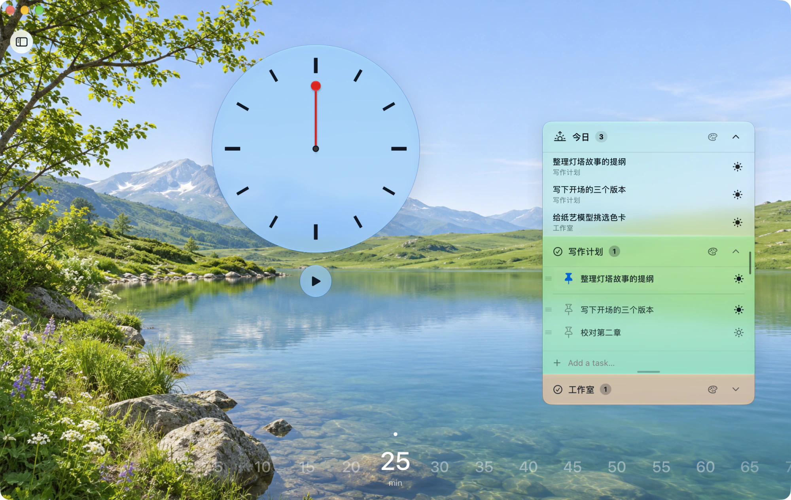
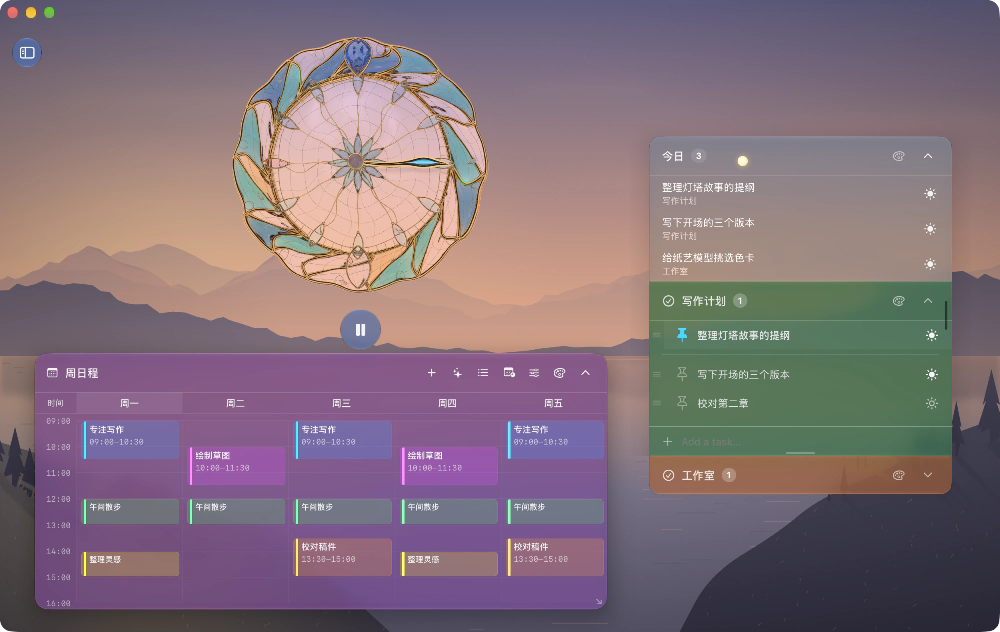
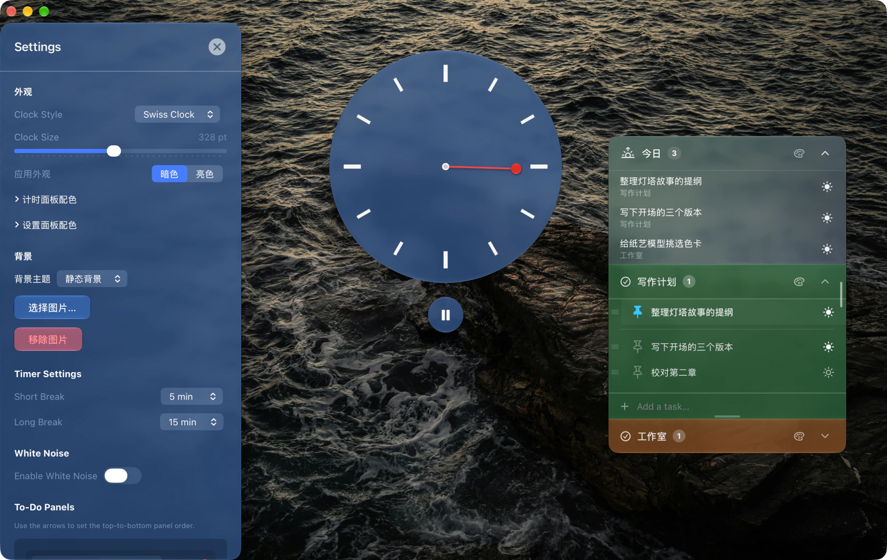
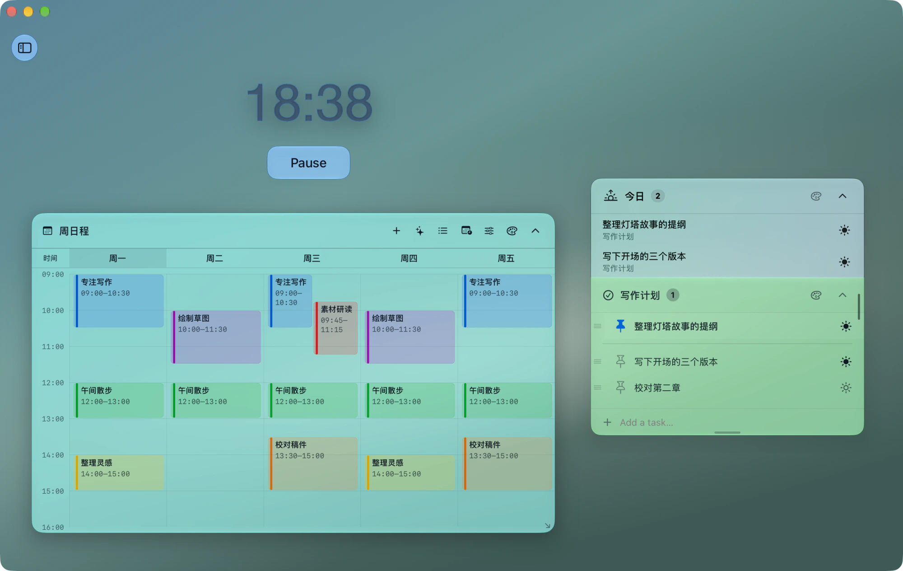

# PomodoroSwift

一款基于 SwiftUI 构建的如原生般优美 macOS 番茄钟应用。它拥有现代化的美学界面，具备玻璃拟态效果和高度的自定义能力。

当前电脑版需要搭载苹果芯片的 Mac 和 macOS 26.2 或更新版本。

## 功能特性

- **计时与专注流程**:
  - 标准番茄钟流程，支持工作时段、短休息、长休息三种模式自动切换。
  - 工作时长、短休息时长、长休息时长均可在侧边栏设置。
  - 计时结束会发送系统通知，可直接从通知中开始短休息、长休息或下一轮专注。
  - 计时面板支持拖拽，位置会自动持久化。

- **声音与氛围**:
  - 内置白噪音、粉红噪音、红噪音、雨声、篝火五种环境声。
  - 支持“仅在计时运行时播放”与独立音量控制。
  - 篝火模拟基于程序化合成，提供 5 种预设与 13 项精细参数调节。

- **待办事项（To-Do）与面板系统**:
  - 支持多待办面板：新增、删除、重命名、位置与尺寸重置。
  - 每个面板可独立拖拽、缩放、折叠，并带网格吸附。
  - 任务支持添加、图钉置顶、双击编辑、删除，置顶区与普通区内可分别拖拽排序。
  - 新置顶任务追加到置顶区末尾，取消置顶后移到普通区顶部；面板只显示置顶数量。
  - 完成任务后直接删除；升级时自动清理旧版已勾选完成的任务。
  - 每个面板可单独设置玻璃样式（颜色、透明度、字体深浅）。

- **智能任务分类（AI）**:
  - 内置任务分类助手，可将输入文本拆分为任务并写入已有待办面板。
  - 只会写入已有面板，不会自动创建新面板。
  - 使用 DashScope 兼容接口，支持失败重试与错误提示。
  - 两个 AI 功能统一使用千问 3.8 快速版（模型标识：qwen3.8-flash），关闭思考模式，以减少录入等待。

- **周日程与日历叠加**:
  - 独立日程面板，默认周一至周五、08:00—17:00，可选择包括周末，并以 15 分钟为单位调整显示范围。
  - 固定安排可选择每周重复的星期几，支持新增、编辑、删除及颜色区分；更改会应用于所有周。
  - 时间网格仅显示星期、时间和日程，留白即空闲；重叠日程并排显示；网格不滚动，全部星期和所选时间范围完整适配面板。日程文字优先换行，再从 11 点逐级缩小；最小字号默认 8 点，可设为 7–11 点。达到下限后仍放不下时省略尾部，悬停可查看完整内容。
  - 第一列可选“本周周一”或“今日”。今日模式显示从今天开始的七天；关闭周末时跳过周六、周日，不把范围延伸到七天以外。
  - 支持按账户分组、多选系统“日历”中的具体日历；只叠加显示周期内的定时事件，保留日历颜色，不显示全天或已取消事件。外部日程带日历图标，点击可查看详情，不会转成每周固定安排。
  - 面板可独立拖动、缩放、折叠，复用全局液态玻璃效果，也可单独调整玻璃样式、着色、不透明度及文字颜色。
  - 日程、显示设置、面板布局与折叠状态保存在本机，重启后恢复。
  - 支持 AI 自然语言批量添加：与任务分类共用通义千问服务密钥，自动识别日程名称、重复日期和准确起止分钟。
  - 添加前整批校验；信息不完整时提示补充，不写入部分结果。相同名称、时间和星期的重复安排会跳过，不覆盖已有日程；支持取消与重试。

- **视觉与个性化**:
  - 支持数字、瑞士倒计时钟、鎏金彩晶三种样式，可在外观设置中切换，表盘大小可调。
  - 鎏金彩晶表盘在支持光线求交的显卡与照片背景下，使用自定义三维网格绘制宝石、镶边、花瓣和单针。连续曲面与封闭背部参与折射、内部反射和颜色吸收；反射环境由当前背景的不同模糊层级估计，并用宽柔补光维持暗背景下的可见性；移动、换背景或缩放时随位置更新。外圈采用十四组不等宽、成对咬合的卷曲彩晶，以及上下垂饰、暗金承托和细金丝；乳白内盘叠放六枚隆起的透明晶瓣与内部金丝，小时刻度为两端收尖的晶叶。此路径不使用系统液态玻璃，也没有成品高光贴图。无照片或显卡不支持时保留此前曲面渲染作为兼容方案。当前仍是实验外观，未完整还原参考图的珠宝工艺。与瑞士表盘共用整段倒计时转一圈的单针进度逻辑。
  - 三维彩晶盘面静止后复用颜色与光路影响缓存，计时只重算当前指针及投影、折光涉及的区域；拖动、缩放、换背景和视角变化时完整更新。计时刷新按针尖的实际移动速度调整为每秒四至三十次，暂停且外观不变时不持续绘制。实体卷边镶座、沿弯曲边界拼合的晶瓣、晶体内部金丝、近处反射和静止时更细的边缘取样用于改善近看细节。
  - 瑞士表盘使用苹果原生液态玻璃，只保留 12 个粗刻度和一根红色圆头针；红针在完整计时内转一圈，刻度代表整段时间的十二等份，暂停和继续与倒计时同步。悬停表盘可查看剩余时间。
  - 瑞士表盘直接沿用全局玻璃样式、颜色和透明度；不显示下方数字，使用圆形开始、暂停按钮，刻度与轴心随深浅外观适配。
  - 表针带柔和投影，光照方向随转动保持一致；红色圆头针使用独立的苹果原生液态玻璃与红色着色，不影响钟体的玻璃设置。
  - 全局液态玻璃效果：样式、色调、透明度、交互光泽可调。
  - 支持深色与浅色界面切换。
  - 支持自定义背景图片与系统字体。
  - 按钮与面板拥有悬停、按压、展开等流畅动画反馈。

## 界面演示

演示中的待办和日程均为虚构内容。

### 晴日山湖与亮色界面

山湖背景为生成图像。

### 湖岸黄昏与「今日」待办

### 海岸照片与暗色界面

海岸照片由 Alessandro Guarino 拍摄。[素材来源与许可](Design/GemstoneDial/Photos/来源.md)

### 雾面光场与周日程

## 项目结构

- **Models**: 核心逻辑，包括计时器（`PomodoroTimer.swift`）、设置模型（`Settings.swift`）、音频引擎管理（`WhiteNoiseManager.swift`）。
- **Views**: SwiftUI 界面层，包括主界面（`ContentView`）、设置页（`SettingsView`）、待办面板（`ToDoView`）及多个自定义组件。
- **Extensions**: 常用扩展与辅助工具。

## 使用说明

1. **开始专注**: 点击“开始”按钮进入倒计时；计时中可暂停、重置或切换休息流程。
2. **打开设置**: 点击左上角侧边栏按钮，调整时长、声音、外观、背景、字体等选项。
3. **管理待办**: 在底部待办面板中添加任务；支持多面板、拖拽排序、面板拖拽缩放。
4. **启用智能分类**: 在“AI 任务分类”区域填入 DashScope API 密钥与任务文本，一键写入已有面板。
5. **接收通知**: 计时结束后可在系统通知中直接开始短休息、长休息或下一轮专注。
6. **安排每周日程**: 在“周日程”标题栏点击加号，或双击时间网格的空白位置添加安排；点击日程色块编辑。列表按钮可管理全部日程，包括隐藏日期和显示时段之外的安排。
7. **选择日历来源**: 点击标题栏的日历时钟按钮，允许系统日历访问后，按账户勾选需要叠加的日历并启用显示。不会预选或写死邮箱。日历必须先在系统“日历”中添加并完成同步；暂时不可用的来源会保留选择。应用回到前台、系统日历变化和每分钟会刷新。
8. **调整日程面板**: 标题栏的显示设置按钮可调整第一列、周末、时间范围及日程最小字号，调色板按钮设置玻璃效果，箭头折叠面板。拖动标题移动、拖动右下角缩放；侧栏“周日程”可隐藏面板或重置位置与尺寸。
9. **AI 添加日程**: 点击周日程标题栏的星光按钮，或侧栏“周日程”中的“AI 添加日程”，输入如“每周一三五上午9点到10点读书；工作日12:00到13:00午餐”。点击“识别并添加日程”后自动写入，并显示添加清单、去重和重叠提示；需要修改时可直接编辑日程色块。一次最多输入6000字、添加50条安排。

手动和 AI 添加的日程用于本机固定周计划，采用当地时间，每周重复；跨午夜的固定安排请拆成两条。隐藏周末或缩小显示范围不会删除日程。系统日历事件按实际日期读取，跨午夜事件自动按天拆分；不会写入、删除或修改系统日历。读取事件需要系统的完整日历访问权限（见[苹果说明](https://developer.apple.com/documentation/eventkit/accessing-the-event-store)），本应用只执行读取，并且不会把日历内容发送给 AI。

AI 日程录入仅向模型服务发送本次输入，不上传已有日程。调用可能产生服务费用。具体日期、仅本周、一次性或含糊的安排需要补充为明确的固定周计划；模型识别可能有误，请核对添加清单。关闭录入窗口会取消尚未完成的请求。

## 手机单向同步

电脑版将待办面板、内容、顺序、置顶、亮暗配色和「今日」的归属与外观写入用户选定的苹果云盘文件夹。手机版只读查看，不会回写电脑版。电脑修改保存后一秒写出，也可手动更新；手机只在点击“立即读取”时更新，两端不定时检查。读取失败或遇到旧版本时保留上次成功结果。

使用「今日」同步需电脑版 1.1.7 构建 27 和手机版 1.6.0。已连接的设备保留原文件夹授权；升级后在电脑点击一次「立即更新」，等待云盘传输，再在手机点击「立即读取」。

首次在电脑版设置的“手机单向同步”中选择文件夹，再在手机选择同一个文件夹。详见 [单向同步说明](PomodoroMobile/SYNC_PLAN.md)。

签名构建时，在本机的 `Config/Signing.local.xcconfig` 中设置 `DEVELOPMENT_TEAM`。
